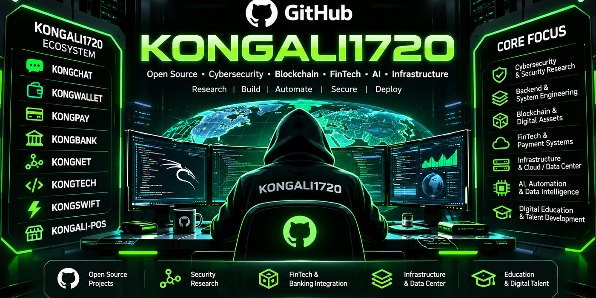
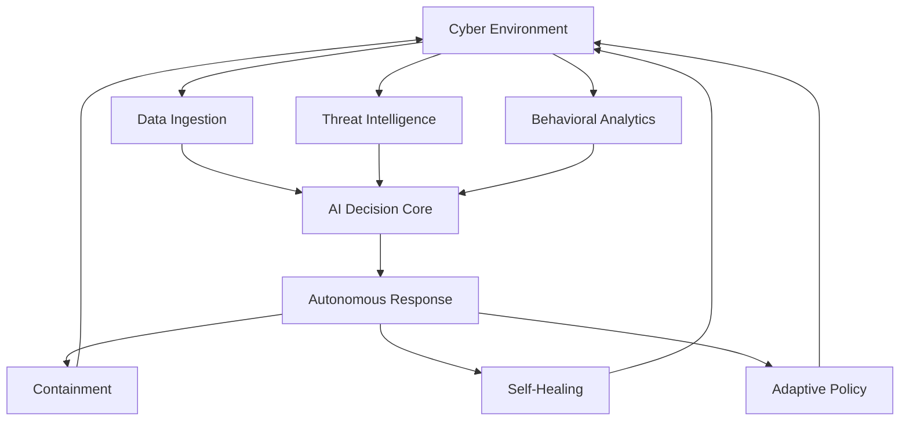
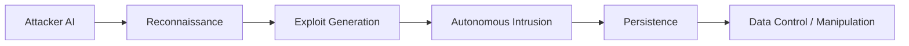
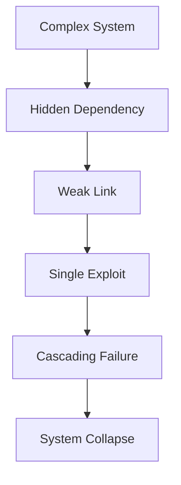
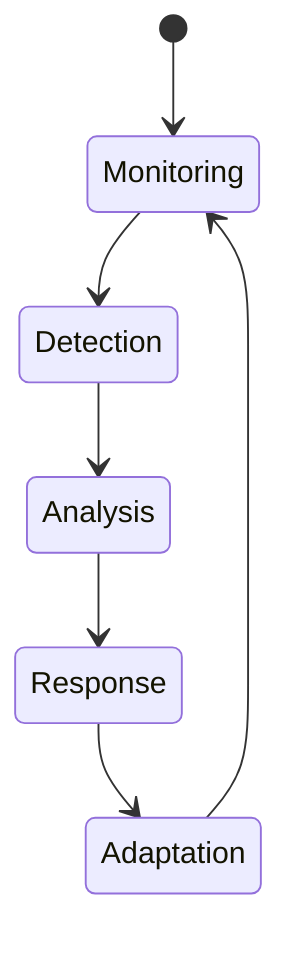

  

# KONGALI1720

### BUILD · SECURE · ANALYZE · INNOVATE

**Independent Developer | Cybersecurity | Software Engineering | Open Source**

Building software, security tools, financial technology experiments,
automation, and digital infrastructure.

---

## 👨‍💻 About Me

I'm an independent developer focused on software engineering,
cybersecurity, digital infrastructure, financial technology,
automation, and open-source development.

My work involves building practical tools, exploring new technologies,
testing ideas, documenting projects, and continuously improving
software systems.

### 🔭 Areas of Focus

- 🛡️ Cybersecurity & Defensive Security
- 💻 Software Engineering & Backend Development
- 🔬 Security Research & System Analysis
- 🏦 Financial Technology & Payment Infrastructure
- ⚙️ Automation & Developer Tooling
- ⛓️ Blockchain & Web3 Technologies
- 🌐 Digital Infrastructure & Systems Engineering

---

## 🔥 Core Competencies

| Domain | Focus |
|---|---|
| 🛡️ Cybersecurity | Cyber Defense, Threat Modeling, Security Architecture, Vulnerability Assessment |
| 🔐 Security Research | OSINT, Threat Intelligence, Adversarial Analysis, Risk Assessment |
| ⚙️ Backend Engineering | API Development, Payment Systems, Backend Services, Integration Design |
| ☁️ Infrastructure & DevSecOps | Linux, Docker, CI/CD, Infrastructure Security, System Reliability |
| 🤖 AI & Automation | AI-Assisted Analysis, Security Automation, Intelligent Workflows |
| ⛓️ Blockchain & Web3 | Wallet Infrastructure, Smart Contracts, Blockchain Integration, On-chain Systems |
| 📊 Engineering | Python, Bash, JavaScript, System Design, Technical Documentation |

---

## 🔬 Security Research Models

Conceptual models exploring cyber defense architecture, adversarial behavior,
systemic risk propagation, and adaptive security operations.

<strong>1. Cyber Intelligence Architecture</strong>

<strong>2. Adversarial Attack Model</strong>

<strong>3. Weak Link Propagation Model</strong>

<strong>4. Cyber Singularity State Machine</strong>

---

## 🛠️ Tech Stack & Tools

---

## 🚀 Featured Projects

### 🔎 Project Focus

| Project | Description |
|---|---|
| [BANK-H2H-FORENSICS](https://github.com/kongali1720/BANK-H2H-FORENSICS) | Financial file analysis, validation, integrity checks, and forensic tooling |
| [KONGALI-POS](https://github.com/kongali1720/KONG-POS) | Retail point-of-sale software development |
| [KongWallet Payment Gateway API](https://github.com/kongali1720/KongWallet-Payment-Gateway-API) | Payment gateway API development and experimentation |
| [Explore All Repositories](https://github.com/kongali1720?tab=repositories) | Explore my open-source projects and technical experiments |

---

## 📊 GitHub Statistics

---

## 🧭 Engineering Principles

- Build practical and useful software.
- Prioritize testing, reliability, and maintainability.
- Document capabilities and limitations honestly.
- Make security and integrity part of the development process.
- Keep learning, experimenting, and improving.
- Welcome constructive collaboration.

---

## 🤝 Open Source & Collaboration

I'm open to collaboration with developers, researchers,
contributors, and builders interested in:

- Software development
- Cybersecurity and defensive tooling
- Automation
- Financial technology
- Documentation and testing
- Open-source projects

Issues, pull requests, feedback, ideas, and constructive discussions
are always welcome.

---

## ☕ Support the Project

If this project has helped your research, learning, or security operations, consider supporting its continued development.

Your support helps sustain development, improve documentation,
maintain existing projects, build new tools, and dedicate more time
to open-source work.

---

### BUILD · SECURE · ANALYZE · INNOVATE

**KONGALI1720 — Open Source Ecosystem**

